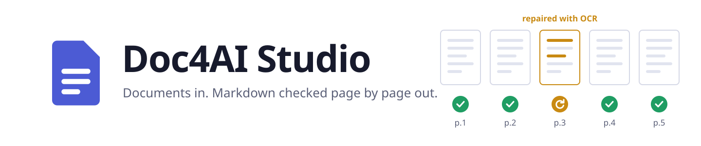
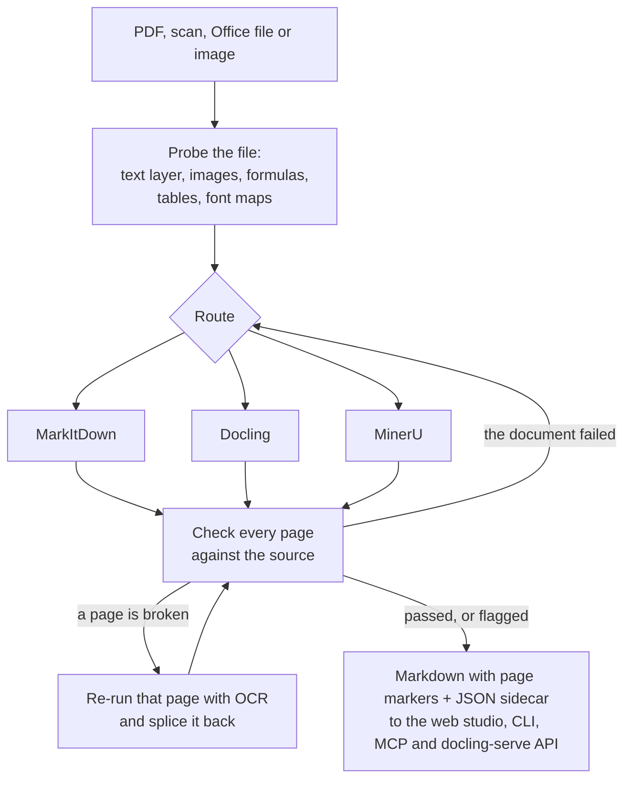
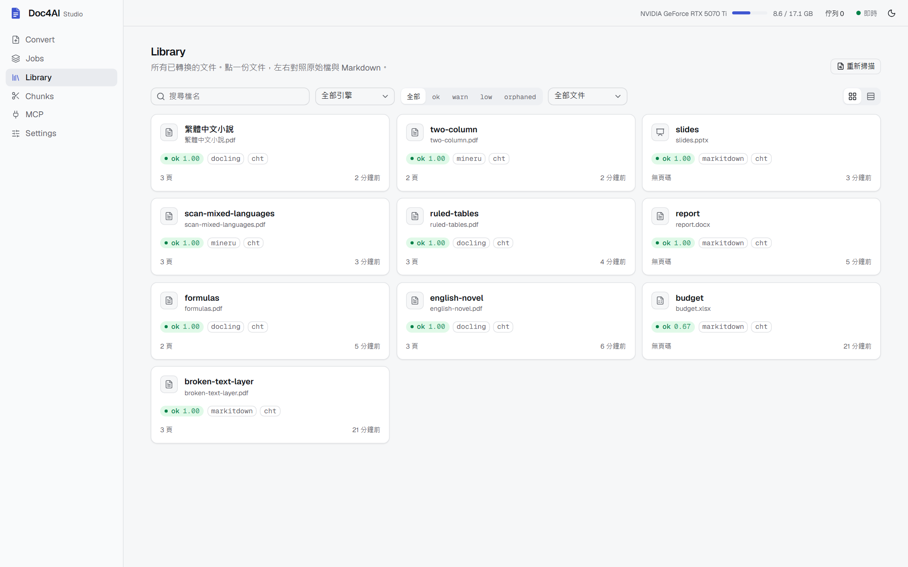
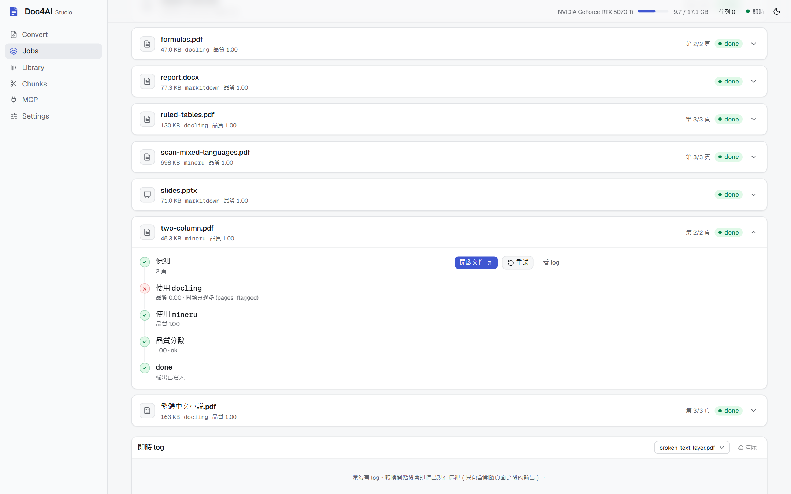
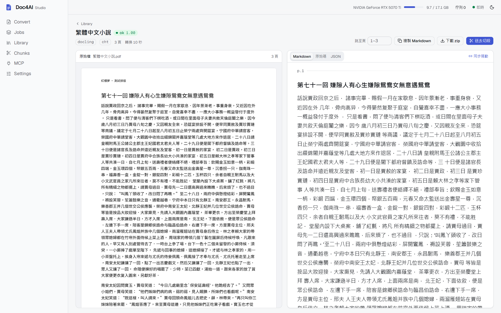
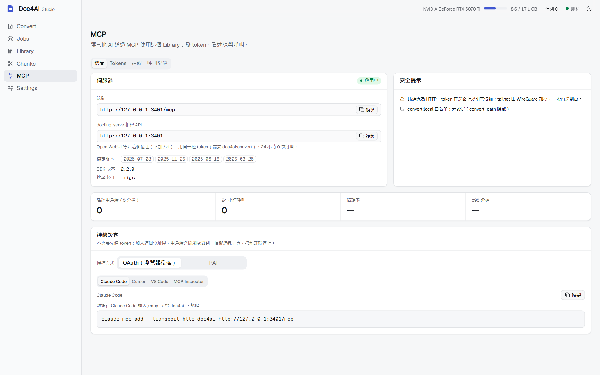

<p align="center">
  <picture>
    <source media="(prefers-color-scheme: dark)" srcset="docs/images/banner-dark.svg">
    
  </picture>
</p>

<p align="center">
  <b>Markdown your AI can trust, from PDFs, scans and Office files.</b><br>
  It picks MarkItDown, Docling or MinerU for each document, checks every page against the source,<br>
  repairs the pages that came back broken, and tells you about the ones it could not fix.
</p>

<p align="center">
  <a href="https://github.com/romanticamaj/doc4ai-studio/actions/workflows/ci.yml"></a>
  <a href="https://github.com/romanticamaj/doc4ai-studio/releases"></a>
  <a href="https://github.com/romanticamaj/doc4ai-studio/pkgs/container/doc4ai-studio"></a>
  
  
  <a href="LICENSE"></a>
</p>

<p align="center">
  English · <a href="README.zh-TW.md">繁體中文</a> · <a href="#quick-start">Quick start</a> · <a href="#connect-your-ai-mcp">Connect your AI</a> · <a href="#documentation">Docs</a>
</p>

<p align="center">
  
</p>

## Why

Every document converter breaks on some documents, and it rarely tells you. A scanned page comes back empty. A font
without a Unicode map turns a chapter into gibberish. A table loses its rows. The converter still returns Markdown,
and your RAG index or your agent reads it as if it were right.

Doc4AI Studio is an orchestrator, not a new parser. It runs three open-source converters side by side, each in its own
environment, and decides from the file itself which one to use. Then it scores the result **page by page** against
the PDF's own text layer. Broken pages are re-run with OCR and spliced back in place. A document that fails as a whole
moves to the next engine. Whatever cannot be repaired is flagged on that page, never hidden.

You get Markdown with `<!-- page: N -->` markers and a JSON sidecar that says how each page was made. It reaches
your AI through a web studio, a CLI, an MCP server, and a docling-serve compatible API.

## What it does

- **Picks an engine per document.** A probe reads the text layer, image coverage, formulas, ruled tables and fonts
  without a Unicode map, then routes to [MarkItDown](https://github.com/microsoft/markitdown),
  [Docling](https://github.com/docling-project/docling) or [MinerU](https://github.com/opendatalab/MinerU).
- **Checks every page and repairs what broke.** Pages with a broken text layer are re-run with OCR (Docling's
  full-page RapidOCR, then MinerU) and put back where they were. Pages it cannot repair carry a flag.
- **Handles large and mixed documents.** PDFs over 40 pages convert in 40-page segments, resume after a crash or a
  cancel, and join tables that cross a segment boundary. Tested on a 1,192-page book. Traditional Chinese and
  English OCR, mixed pages included.
- **Keeps engines apart.** Each engine has its own `uv` environment and runs as a subprocess, so MinerU 4,
  Docling 2 and MarkItDown never fight over torch or onnxruntime versions.
- **Shows its work.** The web studio puts the source and the Markdown side by side with page-synced scrolling, and
  marks each document's quality in the library.
- **Talks to your AI.** An MCP server with browser authorization (OAuth) or scoped personal access tokens, plus an
  admin page for tokens, connected clients and every call.
- **Plugs into RAG platforms.** The same port speaks the docling-serve API, so Open WebUI and others can use Doc4AI
  as their document parser and keep page numbers.
- **Audits other tools.** `doc4ai verify` scores any Markdown against its source PDF, page by page, whoever made it.

## How it works



## Quick start

> [!NOTE]
> The web studio's interface is in Traditional Chinese. The CLI, the API, the MCP tools and these docs are in English.

### Docker: the web studio and MarkItDown, on CPU

```bash
docker run -d --name doc4ai -p 127.0.0.1:8765:8765 \
  -v doc4ai-data:/data -v doc4ai-library:/library \
  ghcr.io/romanticamaj/doc4ai-studio:latest

docker exec doc4ai cat /data/serve.token
```

Open <http://127.0.0.1:8765>, go to 設定 (Settings) and paste the token. The image converts Office files, HTML and
PDFs that have a text layer. Scans need OCR, which comes with Docling and MinerU: install from source on a machine
with an NVIDIA GPU. [`docker-compose.yml`](docker-compose.yml) has a GPU block and a volume for those engines, but
that path is not tested yet.

### From source: every engine, on a GPU

You need Python 3.10+ with [uv](https://docs.astral.sh/uv/), Node 20+ with pnpm, and an NVIDIA GPU for Docling and
MinerU. The engine environments pin CUDA 12.8 PyTorch wheels, which RTX 50-series cards need. It is developed and
tested on Windows 11, and CI runs the test suite on Linux too.

```bash
git clone https://github.com/romanticamaj/doc4ai-studio.git && cd doc4ai-studio
uv sync
uv run doc4ai setup all          # creates the engine environments and downloads models (several GB)
pnpm --dir web install && pnpm --dir web build
uv run doc4ai serve              # http://127.0.0.1:8765
```

Or skip the server and convert from the command line:

```bash
uv run doc4ai convert report.pdf -o out
uv run doc4ai batch ./inbox -o out
uv run doc4ai chunk out --max-tokens 800     # heading-aware RAG chunks with page ranges; tables never split
```

While the server runs, `doc4ai convert` and `doc4ai batch` hand their work to its queue.

By default the server binds to `127.0.0.1`. To expose it on your network, a token is required. Give it through the
`DOC4AI_TOKEN` environment variable (or `server.token` in `doc4ai.toml`), not with `--token`: every local user can read
a process's command line in the process list.

```bash
DOC4AI_TOKEN="$(cat data/serve.token)" uv run doc4ai serve --host 0.0.0.0
```

On Windows, binding a network address brings up the firewall prompt: see [Windows Firewall](docs/windows-firewall.md).
LibreOffice, when installed, gives Office files a PDF preview in the web studio.

## Connect your AI (MCP)

The MCP endpoint is `/mcp` on the same port. Clients that support OAuth (Claude Code, Cursor, VS Code, the MCP Python
SDK, MCP Inspector) need no token: add the URL and approve the connection once in your browser.

```bash
claude mcp add --transport http doc4ai http://127.0.0.1:8765/mcp
```

In Claude Code, type `/mcp`, choose `doc4ai` and authenticate. The browser opens a consent page that shows which
client is asking, where it will return to, and what it may do. Clients without OAuth use a personal access token with
the scopes you choose, created on the web studio's MCP page.

Tools: `search_library`, `list_documents`, `get_document_info`, `read_document` (page ranges, capped at a token
budget and continued with a cursor), `get_chunks`, `convert_document`, `get_job`, `cancel_job`,
`reconvert_document`, `verify_document`, `verify_markdown`, and `convert_path` when you allow local folders.

Setup for each client, token scopes, limits and the local threat model: [docs/mcp.md](docs/mcp.md).

## RAG platforms (docling-serve compatible API)

The same server also speaks the [docling-serve](https://github.com/docling-project/docling-serve) v1 HTTP API
(`/v1/convert/file`, `/v1/convert/source`, the async `…/async` + `/v1/status/poll` + `/v1/result`, `/health`). RAG
platforms that can point their document parser at a docling-serve URL get Doc4AI's routing, page checks and OCR
repair instead, with page numbers: the placeholder a client asks for (`md_page_break_placeholder`) goes between every
two pages. Authentication is an MCP personal access token with `doc4ai:convert`.

Open WebUI (its "Docling" content extraction engine; the token dialog on the MCP page shows this block with the token
filled in):

```bash
CONTENT_EXTRACTION_ENGINE=docling
DOCLING_SERVER_URL=http://<host>:<port>
DOCLING_API_KEY=<YOUR_TOKEN>
```

Recipes, with what is and is not verified: [Open WebUI](docs/integrations/open-webui.md) (tested with Open WebUI
0.11.4), [RAGFlow](docs/integrations/ragflow.md) (RAGFlow 1.0 only connects to a publicly routable URL),
[Kotaemon](docs/integrations/kotaemon.md) (a drop-in reader file), [Dify](docs/integrations/dify.md) (needs a Dify
plugin, not written yet) and [curl or any docling-serve client](docs/integrations/curl.md). Not supported:
server-side URL fetching (`sources[].kind = "http"`), docling chunking endpoints, `json_content` (always `null`).

## What comes out

`two-column.pdf` from the demo library: Docling's result failed the page check, so MinerU converted it again.

```markdown
<!-- page: 1 -->

## CHAPTER XXXVIII.

On Saturday morning Elizabeth and Mr. Collins met for breakfast a few minutes before the others appeared; …
```

The sidecar next to it (`two-column.json`, shortened) records why:

```json
{
  "engine": "mineru",
  "pages": 2,
  "tried": [
    { "engine": "docling", "attempt": 1, "score": 0.0, "reasons": ["pages_flagged"] },
    { "engine": "mineru",  "attempt": 2, "score": 1.0, "reasons": [] }
  ],
  "quality": { "score": 1.0, "level": "ok", "pages_flagged": 0, "pages_unrepaired": 0 },
  "source_copy": { "path": "source/two-column/two-column.pdf", "sha256": "672f457d…" }
}
```

Everything lands in one Doc4AI folder (`C:\doc4ai` or `~/doc4ai` unless you choose another), with a verified copy of
every source file next to its Markdown. Details: [docs/output.md](docs/output.md).

## Screenshots

<table>
  <tr>
    <td width="50%"></td>
    <td width="50%"></td>
  </tr>
  <tr>
    <td></td>
    <td></td>
  </tr>
</table>

## What is measured, and what is not

Doc4AI checks structure: empty or dropped pages, broken text layers, garbage, missing or shifted page markers. It does
not see OCR misreadings or text lost inside images. The benchmark in [`bench/`](bench/) compares routing and repair
against each engine alone on documents with ground truth, but no numbers are published yet: the gate that would let
us publish them (`verify` must track the ground truth) has not passed. The record, including the failed runs, is in
[docs/benchmark.md](docs/benchmark.md).

## When to use something else

Doc4AI Studio is useful when you have a mixed pile of documents (scanned and born-digital PDFs, Office files,
Traditional Chinese), want the conversion checked rather than trusted, and want to share the result with AI clients.
Its full install is heavy, with several GB of models and a GPU for the OCR engines, so a single tool is often the
better choice:

| If you… | Consider |
|---|---|
| only need MinerU, and its own web UI, router and document library are enough | [MinerU](https://github.com/opendatalab/MinerU) 4.0 directly |
| need a Docling conversion API at scale, in containers | [docling-serve](https://github.com/docling-project/docling-serve) |
| want an agent to read local PDFs through a lightweight stdio MCP server with a one-line install | [anymd](https://github.com/SylphxAI/anymd) or [pdf-mcp](https://github.com/jztan/pdf-mcp) |
| only convert PDFs and want a library / CLI with per-page routing, or to audit another engine's output | [pdfmux](https://github.com/NameetP/pdfmux) |
| need a multi-user platform with RBAC, SSO and webhooks around MinerU | [MinerU Tianshu](https://github.com/magicyuan876/mineru-tianshu) |
| only convert Office / HTML files to Markdown | [MarkItDown](https://github.com/microsoft/markitdown) (and its `markitdown-mcp`) |
| want a parser inside a RAG platform | RAGFlow, Open WebUI and Dify already let you pick MinerU or Docling (Doc4AI can stand in for the Docling server: see above) |

## Engines and licenses

| Component | Role here | License |
|---|---|---|
| [MarkItDown](https://github.com/microsoft/markitdown) 0.1.8 | Office files, HTML, EPUB, CSV | MIT |
| [Docling](https://github.com/docling-project/docling) 2.x (+ RapidOCR / EasyOCR) | Born-digital PDFs (layout, tables, reading order); full-page OCR repair | MIT (OCR backends: Apache-2.0) |
| [MinerU](https://github.com/opendatalab/MinerU) 4.0.x | Scanned PDFs, images, formulas, complex layouts (GPU) | MinerU Open Source License (Apache-2.0 based, with additional conditions) |
| VLM OCR (optional, [off by default](docs/vlm.md)) | Any OpenAI-compatible vision endpoint you configure: last fallback and last page repair | depends on the endpoint / model |
| [PyMuPDF](https://github.com/pymupdf/PyMuPDF) | Probing, splitting and checking PDFs in the main program | AGPL-3.0 |
| [LibreOffice](https://www.libreoffice.org/) (optional, external program) | Office → PDF preview in the web studio | MPL-2.0 |

The engines are separate projects installed into their own environments by `doc4ai setup`; they are not redistributed
with this repository. MinerU's license has additional conditions for large-scale or online-service use: check each
project's license before redistributing Doc4AI Studio or offering it as a service.

## Documentation

| Topic | Page |
|---|---|
| MCP clients, OAuth, tokens and the threat model | [docs/mcp.md](docs/mcp.md) |
| The Doc4AI folder, the sidecar and source copies | [docs/output.md](docs/output.md) |
| Verifying any Markdown against its PDF | [docs/verify.md](docs/verify.md) |
| VLM OCR through an OpenAI-compatible endpoint | [docs/vlm.md](docs/vlm.md) |
| Benchmark method and its record | [docs/benchmark.md](docs/benchmark.md) |
| Windows Firewall when serving on a network | [docs/windows-firewall.md](docs/windows-firewall.md) |
| RAG platform recipes | [docs/integrations/](docs/integrations/) |
| Claude Code skill | [skill/SKILL.md](skill/SKILL.md) |

## Contributing

Bug reports with a small sample, docs fixes and code are welcome: see [CONTRIBUTING.md](CONTRIBUTING.md). Report
security problems privately, as [SECURITY.md](SECURITY.md) describes. Changes are listed in
[CHANGELOG.md](CHANGELOG.md).

## License

[AGPL-3.0](LICENSE). If you run a modified version as a network service, the AGPL requires you to offer its source to
the users of that service. The engines keep their own licenses (see above).

Benchmark corpus: the synthetic documents are generated from public-domain Project Gutenberg texts (licence headers
stripped) and the SIL Open Font License 1.1 Noto Sans CJK TC font (downloaded and embedded as subsets, never committed
as a font file); Tier B documents are fetched from their publishers and are not in the repository: Taiwan Open
Government Data License 1.0 (compatible with CC BY 4.0), arXiv CC BY 4.0 papers, and US-government works
(17 U.S.C. §105, may be under copyright elsewhere).
