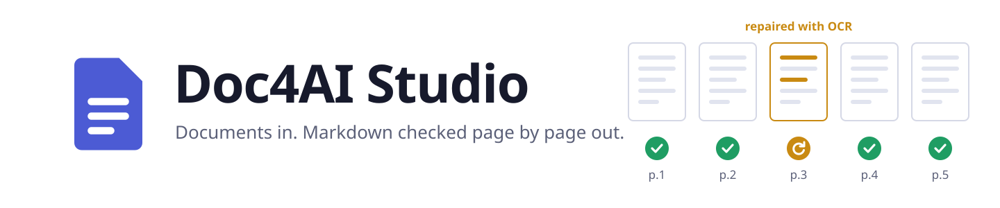
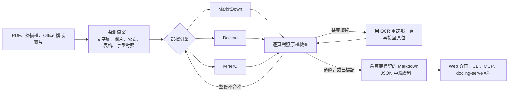
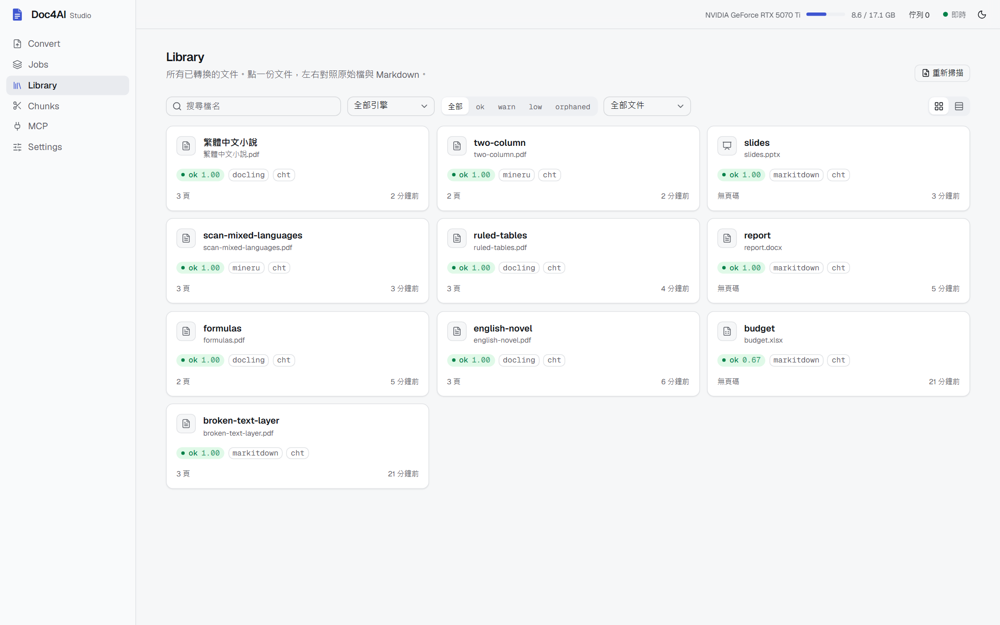
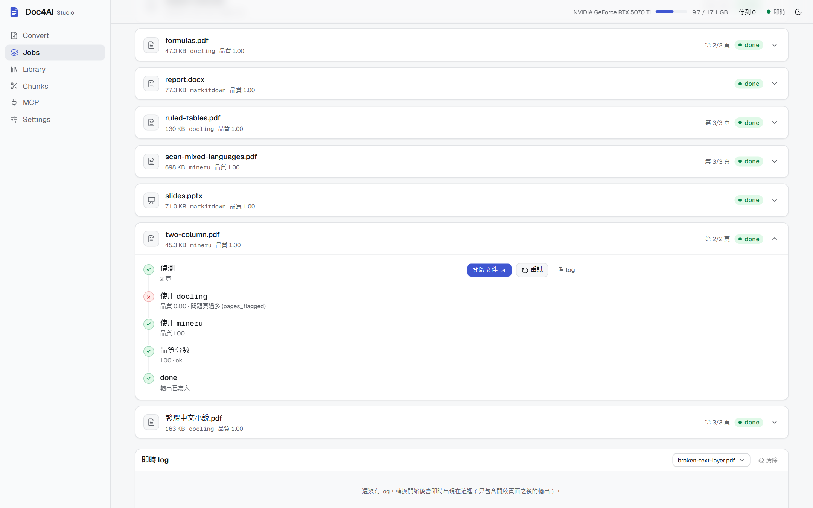
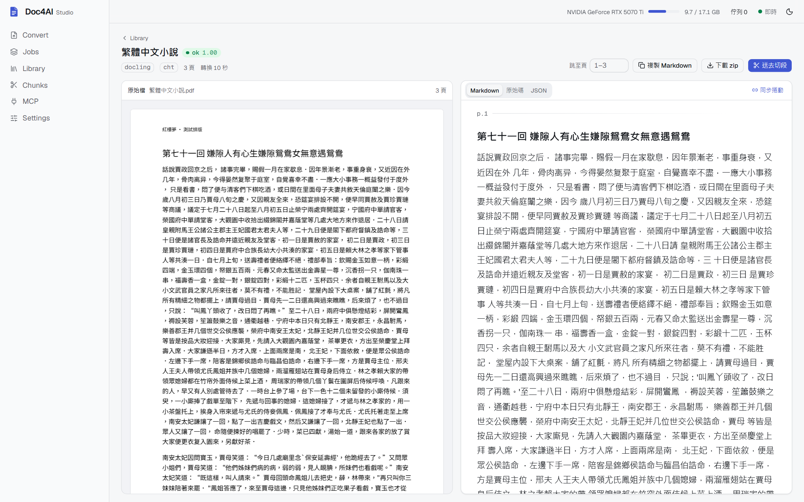
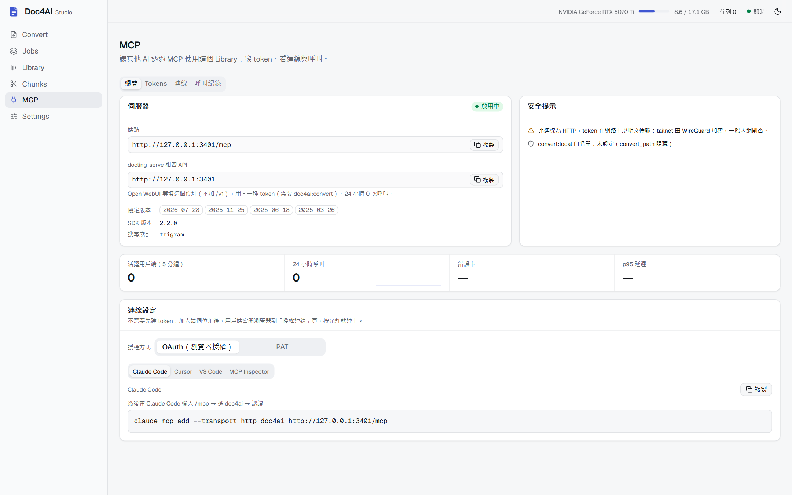

<p align="center">
  <picture>
    <source media="(prefers-color-scheme: dark)" srcset="docs/images/banner-dark.svg">
    
  </picture>
</p>

<p align="center">
  <b>把 PDF、掃描檔、Office 文件轉成 AI 可以信任的 Markdown。</b><br>
  每份文件自動挑 MarkItDown、Docling 或 MinerU 來轉，逐頁對照原檔檢查，<br>
  壞掉的頁面自動修復，修不好的頁面會明確標出來。
</p>

<p align="center">
  <a href="https://github.com/romanticamaj/doc4ai-studio/actions/workflows/ci.yml"></a>
  <a href="https://github.com/romanticamaj/doc4ai-studio/releases"></a>
  <a href="https://github.com/romanticamaj/doc4ai-studio/pkgs/container/doc4ai-studio"></a>
  
  
  <a href="LICENSE"></a>
</p>

<p align="center">
  <a href="README.md">English</a> · 繁體中文 · <a href="#快速開始">快速開始</a> · <a href="#接上你的-aimcp">接上你的 AI</a> · <a href="#文件">文件</a>
</p>

<p align="center">
  
</p>

## 為什麼需要它

每一套文件轉換工具都會在某些文件上出錯，而且通常不會告訴你。掃描頁轉出來是空的，缺 Unicode 對照表的字型讓整章變成亂碼，表格少了好幾列。
轉換工具照樣交出一份看起來正常的 Markdown，你的 RAG 索引或 AI 助理就當作是對的照單全收。

Doc4AI Studio 不是新的解析模型，而是一層編排。它把三套開源轉換工具並排放好，各自裝在獨立環境，再依照檔案本身的特徵決定用哪一套。
轉完之後，用 PDF 自己的文字層**逐頁**評分。壞掉的頁面用 OCR 重跑，接回原來的位置；整份文件不合格就換下一個引擎；修不好的頁面會被標記，絕不隱藏。

你拿到的是帶 `<!-- page: N -->` 頁碼標記的 Markdown，加上一份 JSON 中繼資料，記錄每一頁是怎麼產生的。
結果可以透過 Web 介面、CLI、MCP server，以及 docling-serve 相容 API 交給你的 AI。

## 它能做什麼

- **每份文件挑最適合的引擎。** 先探測文字層、圖片比例、公式、格線表格和缺 Unicode 對照的字型，再決定交給
  [MarkItDown](https://github.com/microsoft/markitdown)、[Docling](https://github.com/docling-project/docling)
  或 [MinerU](https://github.com/opendatalab/MinerU)。
- **逐頁檢查，壞頁自動修。** 文字層壞掉的頁面用 OCR 重跑（先用 Docling 的整頁 RapidOCR，再用 MinerU），放回原位。修不好的頁面會帶上標記。
- **大文件、混合文件都能處理。** 超過 40 頁的 PDF 分成每段 40 頁轉換，當機或取消後可以續跑，跨段的表格會接回來。實測過 1,192 頁的書。
  支援繁體中文和英文 OCR，中英混排也可以。
- **引擎互不干擾。** 每個引擎有自己的 `uv` 環境，以子程序執行，MinerU 4、Docling 2 和 MarkItDown 不會因為 torch 或 onnxruntime 版本打架。
- **過程看得見。** Web 介面把原檔和 Markdown 左右對照，捲動時頁面同步；文件庫裡每份文件都標示品質。
- **直接接上你的 AI。** 內建 MCP server，可以用瀏覽器授權（OAuth）或設定權限範圍的個人存取 token；管理頁面列出 token、已連線的用戶端和每一次呼叫。
- **接得上 RAG 平台。** 同一個 port 也提供 docling-serve API，Open WebUI 等平台可以把 Doc4AI 當成文件解析器，頁碼照樣保留。
- **也能稽核別的工具。** `doc4ai verify` 可以拿任何 Markdown 對照原始 PDF 逐頁評分，不論是誰轉的。

## 運作方式



## 快速開始

### Docker：Web 介面加 MarkItDown，只用 CPU

```bash
docker run -d --name doc4ai -p 127.0.0.1:8765:8765 \
  -v doc4ai-data:/data -v doc4ai-library:/library \
  ghcr.io/romanticamaj/doc4ai-studio:latest

docker exec doc4ai cat /data/serve.token
```

打開 <http://127.0.0.1:8765>，到「設定」貼上 token。這個映像檔能轉 Office 檔、HTML，以及有文字層的 PDF。
掃描檔需要 OCR，要靠 Docling 和 MinerU，請在有 NVIDIA GPU 的電腦上從原始碼安裝。
[`docker-compose.yml`](docker-compose.yml) 裡有 GPU 設定區塊和存放引擎的 volume，但這條路還沒測試過。

### 從原始碼安裝：所有引擎，使用 GPU

需要 Python 3.10 以上加 [uv](https://docs.astral.sh/uv/)、Node 20 以上加 pnpm，Docling 和 MinerU 需要 NVIDIA GPU。
引擎環境固定使用 CUDA 12.8 的 PyTorch，RTX 50 系列需要這個版本。主要在 Windows 11 上開發與測試，CI 也會在 Linux 上跑整套測試。

```bash
git clone https://github.com/romanticamaj/doc4ai-studio.git && cd doc4ai-studio
uv sync
uv run doc4ai setup all          # 建立各引擎環境並下載模型（數 GB）
pnpm --dir web install && pnpm --dir web build
uv run doc4ai serve              # http://127.0.0.1:8765
```

不開 server，也可以直接用命令列轉換：

```bash
uv run doc4ai convert report.pdf -o out
uv run doc4ai batch ./inbox -o out
uv run doc4ai chunk out --max-tokens 800     # 依標題切成 RAG 區塊，附頁碼範圍，表格不會被切開
```

server 開著的時候，`doc4ai convert` 和 `doc4ai batch` 會把工作交給 server 的佇列。

server 預設只綁定 `127.0.0.1`。要開放到區網，就必須設定 token。請用 `DOC4AI_TOKEN` 環境變數（或 `doc4ai.toml` 的 `server.token`）傳入，
不要用 `--token`：同一台電腦的其他使用者都能在程序清單看到命令列參數。

```bash
DOC4AI_TOKEN="$(cat data/serve.token)" uv run doc4ai serve --host 0.0.0.0
```

在 Windows 上綁定網路位址會跳出防火牆詢問，請看 [Windows 防火牆](docs/windows-firewall.md)。
安裝了 LibreOffice 的話，Web 介面可以把 Office 檔顯示成 PDF 預覽。

## 接上你的 AI（MCP）

MCP 端點是同一個 port 的 `/mcp`。支援 OAuth 的用戶端（Claude Code、Cursor、VS Code、MCP Python SDK、MCP Inspector）不需要 token：
加入網址後，在瀏覽器裡同意一次就好。

```bash
claude mcp add --transport http doc4ai http://127.0.0.1:8765/mcp
```

在 Claude Code 輸入 `/mcp`，選 `doc4ai` 並進行認證。瀏覽器會打開「授權連線」頁面，列出是哪個用戶端在要求、授權後會回到哪裡，以及它能做什麼。
不支援 OAuth 的用戶端，請到 Web 介面的 MCP 頁面建立個人存取 token，自行選擇權限範圍。

工具：`search_library`、`list_documents`、`get_document_info`、`read_document`（可指定頁碼範圍，每次回應有 token 上限，用 cursor 接續）、
`get_chunks`、`convert_document`、`get_job`、`cancel_job`、`reconvert_document`、`verify_document`、`verify_markdown`，
以及允許本機資料夾後才出現的 `convert_path`。

各用戶端的設定方式、權限範圍、限制和本機威脅模型：[docs/mcp.md](docs/mcp.md)（英文）。

## RAG 平台（docling-serve 相容 API）

同一個 server 也提供 [docling-serve](https://github.com/docling-project/docling-serve) v1 HTTP API。
能把文件解析器指向 docling-serve 網址的 RAG 平台，就能改用 Doc4AI 的引擎選擇、逐頁檢查和 OCR 修復，而且保留頁碼。
驗證方式是具備 `doc4ai:convert` 權限的 MCP 個人存取 token。

Open WebUI（「Docling」內容擷取引擎；MCP 頁面的 token 對話框會直接帶入 token 顯示這段設定）：

```bash
CONTENT_EXTRACTION_ENGINE=docling
DOCLING_SERVER_URL=http://<host>:<port>
DOCLING_API_KEY=<YOUR_TOKEN>
```

各平台的設定說明與驗證狀態：[Open WebUI](docs/integrations/open-webui.md)、[RAGFlow](docs/integrations/ragflow.md)、
[Kotaemon](docs/integrations/kotaemon.md)、[Dify](docs/integrations/dify.md)、[curl 或任何 docling-serve 用戶端](docs/integrations/curl.md)。

## 轉出來長什麼樣子

以 demo 文件庫裡的 `two-column.pdf` 為例：Docling 的結果沒通過逐頁檢查，所以改由 MinerU 重新轉換。

```markdown
<!-- page: 1 -->

## CHAPTER XXXVIII.

On Saturday morning Elizabeth and Mr. Collins met for breakfast a few minutes before the others appeared; …
```

旁邊的中繼資料（`two-column.json`，節錄）記錄了原因：

```json
{
  "engine": "mineru",
  "pages": 2,
  "tried": [
    { "engine": "docling", "attempt": 1, "score": 0.0, "reasons": ["pages_flagged"] },
    { "engine": "mineru",  "attempt": 2, "score": 1.0, "reasons": [] }
  ],
  "quality": { "score": 1.0, "level": "ok", "pages_flagged": 0, "pages_unrepaired": 0 },
  "source_copy": { "path": "source/two-column/two-column.pdf", "sha256": "672f457d…" }
}
```

所有東西都放在同一個 Doc4AI 資料夾（預設 `C:\doc4ai` 或 `~/doc4ai`，可以自行指定），每份原始檔都會留一份驗證過的備份，和它的 Markdown 放在一起。
詳細說明：[docs/output.md](docs/output.md)（英文）。

## 畫面

<table>
  <tr>
    <td width="50%"></td>
    <td width="50%"></td>
  </tr>
  <tr>
    <td></td>
    <td></td>
  </tr>
</table>

## 量了什麼，還沒量什麼

Doc4AI 檢查的是結構：空白或遺漏的頁面、壞掉的文字層、亂碼、遺漏或錯位的頁碼標記。它看不出 OCR 認錯字，也看不到圖片裡漏掉的文字。
[`bench/`](bench/) 裡的基準測試會拿有標準答案的文件，比較「自動選引擎加修復」和「單一引擎」的差異，但目前還沒公布任何數字：
允許公布的門檻（`verify` 必須能追上標準答案）還沒通過。完整紀錄，包括失敗的幾次，都在 [docs/benchmark.md](docs/benchmark.md)（英文）。

## 什麼時候該用別的工具

Doc4AI Studio 適合這種情況：手上有一堆混雜的文件（掃描和原生 PDF、Office 檔、繁體中文），希望轉換結果經過檢查而不是直接相信，還要把結果交給 AI 用。
完整安裝很重，要好幾 GB 的模型，OCR 引擎還需要 GPU，所以很多時候單一工具反而更合適：

| 如果你… | 可以考慮 |
|---|---|
| 只需要 MinerU，而且它自己的 Web UI、路由和文件庫就夠用 | 直接用 [MinerU](https://github.com/opendatalab/MinerU) 4.0 |
| 需要大規模、容器化的 Docling 轉換 API | [docling-serve](https://github.com/docling-project/docling-serve) |
| 想讓 AI 助理透過一行安裝的輕量 stdio MCP 讀本機 PDF | [anymd](https://github.com/SylphxAI/anymd) 或 [pdf-mcp](https://github.com/jztan/pdf-mcp) |
| 只轉 PDF，想要有逐頁路由的函式庫或 CLI，或稽核別的引擎的輸出 | [pdfmux](https://github.com/NameetP/pdfmux) |
| 需要圍繞 MinerU、有 RBAC、SSO 和 webhook 的多使用者平台 | [MinerU Tianshu](https://github.com/magicyuan876/mineru-tianshu) |
| 只把 Office 或 HTML 轉成 Markdown | [MarkItDown](https://github.com/microsoft/markitdown)（以及它的 `markitdown-mcp`） |
| 要在 RAG 平台裡用解析器 | RAGFlow、Open WebUI 和 Dify 本來就能選 MinerU 或 Docling（Doc4AI 可以頂替 Docling server，見上方） |

## 引擎與授權

| 元件 | 在這裡的角色 | 授權 |
|---|---|---|
| [MarkItDown](https://github.com/microsoft/markitdown) 0.1.8 | Office 檔、HTML、EPUB、CSV | MIT |
| [Docling](https://github.com/docling-project/docling) 2.x（+ RapidOCR / EasyOCR） | 原生 PDF（版面、表格、閱讀順序）；整頁 OCR 修復 | MIT（OCR 後端：Apache-2.0） |
| [MinerU](https://github.com/opendatalab/MinerU) 4.0.x | 掃描 PDF、圖片、公式、複雜版面（GPU） | MinerU Open Source License（以 Apache-2.0 為基礎，附加條件） |
| VLM OCR（選用，[預設關閉](docs/vlm.md)） | 你設定的任何 OpenAI 相容視覺端點：最後的備援與最後的頁面修復 | 依端點和模型而定 |
| [PyMuPDF](https://github.com/pymupdf/PyMuPDF) | 主程式裡的 PDF 探測、切分與檢查 | AGPL-3.0 |
| [LibreOffice](https://www.libreoffice.org/)（選用，外部程式） | Web 介面的 Office → PDF 預覽 | MPL-2.0 |

各引擎是獨立的專案，由 `doc4ai setup` 安裝到各自的環境，不隨本 repo 散布。MinerU 的授權對大規模或線上服務的使用有附加條件：
要再散布 Doc4AI Studio 或拿來提供服務之前，請先確認每個專案的授權。

## 文件

| 主題 | 頁面 |
|---|---|
| MCP 用戶端、OAuth、token 與威脅模型 | [docs/mcp.md](docs/mcp.md) |
| Doc4AI 資料夾、中繼資料與原始檔備份 | [docs/output.md](docs/output.md) |
| 拿任何 Markdown 對照 PDF 驗證 | [docs/verify.md](docs/verify.md) |
| 透過 OpenAI 相容端點使用 VLM OCR | [docs/vlm.md](docs/vlm.md) |
| 基準測試方法與紀錄 | [docs/benchmark.md](docs/benchmark.md) |
| 在網路上提供服務時的 Windows 防火牆 | [docs/windows-firewall.md](docs/windows-firewall.md) |
| RAG 平台設定 | [docs/integrations/](docs/integrations/) |
| Claude Code skill | [skill/SKILL.md](skill/SKILL.md) |

上面的文件目前只有英文版。

## 參與貢獻

歡迎附上小樣本的錯誤回報、文件修正和程式碼，請看 [CONTRIBUTING.md](CONTRIBUTING.md)。資安問題請依 [SECURITY.md](SECURITY.md) 私下回報。
版本變更記錄在 [CHANGELOG.md](CHANGELOG.md)。

## 授權

[AGPL-3.0](LICENSE)。如果你把修改過的版本當成網路服務提供，AGPL 要求你把原始碼提供給該服務的使用者。各引擎維持各自的授權（見上方）。
